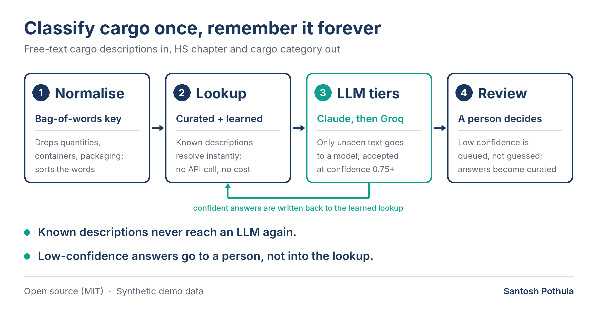

# HS Cargo Classifier

Classify free-text cargo descriptions into **HS chapters** and business categories, cheaply and reliably, using a tiered flow: **lookup first, LLM only for what is new, a person for what is unclear.**

> **Clean-room demo.** All data in this repo is synthetic and generated by `hsclass generate`. The business categories are an invented demo taxonomy. No employer or client data, schemas or rules are included.



## The problem

Shipping and customs records carry cargo as messy free text: `1X40HC 24 PALLETS FROZEN BONELESS BEEF`, `boneless frozen beef - 18.5 MT`, `BREAKFAST CEREALS ORIGIN TURKIYE`. Reporting needs a clean category. Classifying by hand does not scale, and sending every row to an LLM is slow and expensive when the same goods appear thousands of times.

## How it works

| Tier | What happens | Cost |
|---|---|---|
| **1. Normalise** | Strip quantities, container codes, packaging and origin words; sort the remaining words into a bag-of-words key. Every variant of the same goods gets the same key. | free |
| **2. Lookup** | A *curated* table (maintained by people) and a *learned* table (written by the pipeline). A hit resolves the row instantly. | free |
| **3. Providers** | Only unseen keys go to a provider, in order: Claude, then Groq (any order you choose). Answers at or above the confidence threshold (default 0.75) are accepted and written to the learned table. | tokens |
| **4. Review** | Anything still unresolved lands in `review_queue.csv` with the best low-confidence guess. A person fills in the chapter and `hsclass learn` promotes it into the curated table. | human |

Each run therefore gets cheaper: the learned table grows, so fewer keys reach a provider.

## Design decisions

- **Work per unique description, in batches.** A description seen 500 times costs at most one provider answer, and unseen ones are sent 25 at a time.
- **Curated and learned lookups are separate files.** Automatic learning can never overwrite a human decision, and the learned file can be audited and promoted.
- **Low confidence is never written back.** An unsure answer would otherwise poison the lookup and repeat forever. It goes to review instead.
- **LLM output is validated, not trusted.** Replies must be JSON; chapters must be 1-97 and never the reserved chapter 77; unknown ids, bad numbers and NaN are dropped; confidence is clamped. A malformed batch falls through to the next tier.
- **Provider fallback.** If one provider fails or is unsure, the next gets a try.
- **Runs offline.** An offline keyword matcher stands in for the LLM so you can run everything with no API key (see *Limitations* for what that does and does not show).

## Quick start

```bash
pip install -r requirements.txt

python run.py generate                              # synthetic data into ./data
python run.py classify --providers heuristic        # first run
python run.py evaluate                              # compare with the synthetic ground truth
python run.py classify --providers heuristic        # second run: watch the lookup do the work
```

Windows PowerShell works the same way. Outputs land in `output/`:

| File | Contents |
|---|---|
| `classified.csv` | one row per input record: HS chapter, chapter title, cargo category, edible flag, method, confidence |
| `review_queue.csv` | one row per unresolved description, most frequent first, with a blank `hs_chapter` column to fill in |
| `run_stats.json` | counts per tier, provider calls and failures |

Close the loop on the review queue:

```bash
# fill in hs_chapter in output/review_queue.csv, then:
python run.py learn --reviewed output/review_queue.csv
```

### With real LLMs

```bash
# bash
export ANTHROPIC_API_KEY=...
export GROQ_API_KEY=...
python run.py classify --providers anthropic,groq
```

```powershell
# PowerShell
$env:ANTHROPIC_API_KEY="..."
$env:GROQ_API_KEY="..."
python run.py classify --providers anthropic,groq
```

`--providers auto` (the default) uses Claude and Groq when their keys are set, and the offline matcher otherwise. Models can be changed with `CLAUDE_MODEL` and `GROQ_MODEL`. The defaults are `claude-sonnet-5-5` and `llama-3.3-70b-versatile`; **check that these model names are still available on your account**, since providers retire models.

## Results on the demo data

2,000 synthetic records, seed 42, 69 curated seed entries, offline matcher, default threshold:

| | Run 1 | Run 2 (same input) |
|---|---|---|
| Unique descriptions | 226 | 226 |
| Resolved by lookup, no provider needed | 66 | 205 |
| Resolved by the provider | 139 | 0 |
| Sent to review | 21 | 21 |
| New learned entries | 139 | 0 |
| Rows resolved from lookup | 45% | 95% |

The second run needs no provider answers at all except for the 21 review items, which is the point of the design.

**Read the accuracy figure with care.** On answered records, accuracy is 100% on this demo, but that number says very little: the offline matcher's keywords overlap the vocabulary of the synthetic data, so it is close to grading its own homework. It is **not** a benchmark of the approach or of any LLM. The LLM providers are tested here only against fakes (see Tests); they have not been run against live APIs in this repo, and no LLM accuracy is claimed. To measure real accuracy, run `classify` on your own labelled data and use `evaluate --truth-col`.

## Using it in Power BI

`classified.csv` is the fact table and `data/dim_hs_chapter.csv` (written by `generate`) is a chapter dimension with title, category and edible flag. Relate `classified[hs_chapter]` to `dim_hs_chapter[hs_chapter]` (many-to-one). Rows in review have a blank chapter and the category "Needs review", so unresolved volume stays visible instead of silently disappearing.

## Project layout

```
src/hsclass/
  hs_reference.py   HS chapters 1-97 (short titles) and the demo taxonomy
  normalise.py      bag-of-words key
  lookup.py         curated + learned lookup
  providers.py      Claude, Groq, offline matcher, reply validation
  pipeline.py       the tiered flow
  generate.py       synthetic data with ground truth
  cli.py            generate | classify | evaluate | learn
data/               synthetic sample, curated seed, chapter dimension
tests/              27 unit tests (standard library only)
```

## Tests

```bash
python -m unittest discover -s tests
```

The suite covers normalisation, lookup rules, reply validation, tier ordering, fallback on failure and low confidence, learning rules, and the CLI end to end. The Groq and Claude clients are exercised with fake HTTP and a fake SDK, so retry and wiring logic is tested but live API behaviour is not.

## Limitations

- **Chapter level only** (2 digits). Real customs work needs 6 to 10 digit codes, which are country-specific.
- **The key is a bag of words.** It ignores word order and treats words like `PALLETS` as packaging, so the goods `WOODEN PALLETS` are not recognised as such and go to review.
- **Typos create new keys**, which then go to a provider or to review. Fuzzy matching would reduce this.
- **Review items are asked again every run**, which costs tokens with a real LLM. A "known unsure" cache would avoid that.
- **The taxonomy is invented.** Replace `hs_reference.py` categories and the edible rule with your own.
- **Chapter titles are short paraphrases** of the public HS headings. Check the official WCO text before relying on exact wording.
- This is a demo for engineering and reporting, not customs or legal advice.

## Ideas for next steps

- Heading-level (4-digit) classification with a country tariff table
- Fuzzy matching on keys and a negative cache for known-unsure descriptions
- A Microsoft Fabric notebook variant writing to a Lakehouse
- Evaluation against a real labelled sample, per chapter

## License

MIT, see `LICENSE`. The Harmonized System is a World Customs Organization standard.

Author: Santosh Pothula
